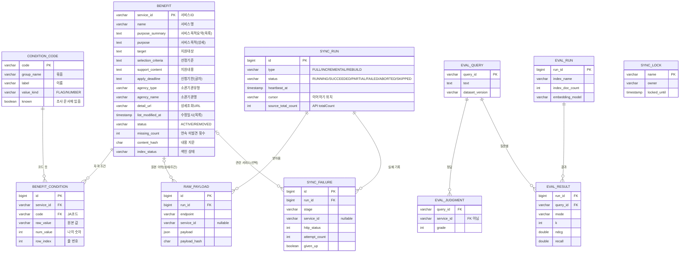

# 도메인·엔티티 설계

> 상태: **1단계 승인 (2026-11-14).** [미확인] 항목은 실제 API 확인 후 바뀔 수 있고, 바꿀 때는 다시 승인받는다. [미확인] = gov24-api.md 미확인 항목에 기대는 것.
> 바운디드 컨텍스트 = 서로 관련 깊은 기능과 데이터를 묶은 단위. 묶음끼리는 정해진 통로로만 데이터를 주고받는다.

## 1. 바운디드 컨텍스트

| 컨텍스트 | 하는 일 | 가진 데이터 | 저장 위치 |
|---|---|---|---|
| 수집(Ingestion) | 공공 API 호출, 검사·정리, 원본 보관, 실행 기록, 중복 실행 방지 | SyncRun, SyncFailure, RawPayload, SyncLock | RDB |
| 혜택 카탈로그(Catalog) | 정리된 혜택 정보와 자격 조건의 기준 데이터 | Benefit, BenefitCondition, ConditionCode | RDB (기준 원본) |
| 검색(Search) | 임베딩, 색인, BM25/kNN/RRF 검색 | BenefitDocument | ES (RDB에서 언제든 다시 만들 수 있는 복사본) |
| 상담(Chat) | 조건 추출, 프롬프트 조립, LLM 호출, 인용 검증, 개인정보 마스킹 | 요청 처리 중에만 존재 (저장 안 함, Q-14) | 메모리 |
| 평가(Evaluation) | 질문 셋, 지표 계산, 지연 측정 | EvalQuery, EvalJudgment, EvalRun, EvalResult | 질문 셋은 git 파일, 실행 결과는 RDB 또는 파일 (Q-24) |
| 운영(Ops) | 요청 한도, 운영 기능 보호, 지표 | 요청 한도 카운터 | 메모리 (task가 1개일 때, Q-16) |

흐름: 수집 → 카탈로그(RDB) → 검색(ES) ← 상담 ← 사용자. 평가는 검색과 상담을 호출한다.

## 2. 엔티티와 필드

### 2.1 Benefit (혜택 서비스), RDB 테이블 `benefit`

목록(serviceList)과 상세(serviceDetail)에서 **이름이 다른 3쌍**(서비스목적요약↔서비스목적, 접수기관↔접수기관명, 전화문의↔문의처)은 같은 뜻인지 [미확인]이라서 **따로 저장**한다. 화면과 검색에서 어느 쪽을 먼저 쓸지는 Q-10에서 정한다.

| 컬럼 | 타입(초안) | 공공 API 필드 (출처) | 설명 |
|---|---|---|---|
| service_id | varchar(64) PK | 서비스ID (목록·상세·조건) | 실측: 항상 12자, 숫자 또는 대문자+숫자 |
| name | varchar(500) | 서비스명 (목록·상세) | 필수 (실측: 전부 있음) |
| purpose_summary | text | 서비스목적요약 (목록) | |
| purpose | text | 서비스목적 (상세) | |
| target | text | 지원대상 (목록·상세) | |
| selection_criteria | text | 선정기준 (목록·상세) | |
| support_content | text | 지원내용 (목록·상세) | |
| apply_method | text | 신청방법 (목록·상세) | |
| apply_deadline | text | 신청기한 (목록·상세) | 날짜로 해석하지 않고 글자로 저장 |
| apply_deadline_type | varchar(50) | 신청기한유형 (목록·상세) | 실측으로 새로 찾은 필드. 직접입력 / 상시신청 / 접수기관별상이 / 기간설정 (SYNC-5-E10) |
| support_type | varchar | 지원유형 (목록·상세) | |
| service_field | varchar | 서비스분야 (목록) | |
| user_type | varchar | 사용자구분 (목록) | 값이 여러 개 들어오는지 [미확인] |
| agency_type | varchar | 소관기관유형 (목록) | 지역 추정에 쓸 후보 (Q-06) |
| agency_name | varchar | 소관기관명 (목록·상세) | 지역 추정에 쓸 후보 (Q-06) |
| agency_code | varchar | 소관기관코드 (목록) | |
| department | varchar | 부서명 (목록) | |
| reception_org | text | 접수기관 (목록) | |
| reception_org_name | text | 접수기관명 (상세) | |
| contact_phone | text | 전화문의 (목록) | |
| contact | text | 문의처 (상세) | |
| detail_url | varchar(2000) | 상세조회URL (목록) | 인용 링크. http/https만 허용 |
| online_apply_url | varchar(2000) | 온라인신청사이트URL (상세) | |
| view_count | bigint null | 조회수 (목록) | |
| required_docs | text | 구비서류 (상세) | |
| self_verify_docs | text | 본인확인필요구비서류 (상세) | |
| official_verify_docs | text | 공무원확인구비서류 (상세) | |
| laws | text | 법령 (상세) | |
| local_laws | text | 자치법규 (상세) | |
| admin_rules | text | 행정규칙 (상세) | |
| source_registered_at | timestamp null | 등록일시 (목록) | `yyyyMMddHHmmss`, KST로 해석 |
| list_modified_at | timestamp null | 수정일시 (목록) | `yyyyMMddHHmmss`, KST로 해석 |
| detail_modified_at | timestamp null | 수정일시 (상세) | `yyyyMMddHHmmss`, KST로 해석 |
| status | varchar | (우리 값) | ACTIVE / REMOVED |
| missing_count | int | (우리 값) | 성공한 전체 수집에서 연속으로 안 보인 횟수 (Q-11) |
| first_seen_at / last_seen_at / removed_at | timestamp | (우리 값) | |
| content_hash | char(64) | (우리 값) | 정리된 내용의 지문. 바뀌었는지 판단하는 데 쓴다. 조회수(view_count)는 매일 바뀌므로 넣지 않는다(hash_version 2부터, SYNC-1-H) |
| hash_version | int | (우리 값) | 지문 계산 규칙의 버전. 1: 조회수 포함, 2: 조회수 제외(2026-11-24). null은 1과 같이 옛 규칙으로 본다(지문이 달라 그 행이 다시 수집되는 실행에서 한 번 갱신됨, SYNC-1-H12) |
| index_status | varchar | (우리 값) | PENDING / INDEXED / PENDING_EMBEDDING / PENDING_DELETE / FAILED |
| indexed_hash | char(64) null | (우리 값) | ES에 마지막으로 반영한 내용의 지문 |
| detail_status | varchar | (우리 값) | OK / MISSING (상세를 못 받은 경우, Q-10) |
| created_at / updated_at / version | | (우리 값) | version은 동시 수정 감지(낙관적 락)용 |

### 2.2 BenefitCondition (자격 조건), RDB 테이블 `benefit_condition`

조사 문서는 "서비스ID당 한 줄"이라고 **추정**했다 [미확인]. 코드가 바뀌어도 테이블을 고치지 않도록 **세로형(코드 하나당 한 행)** 으로 저장하자고 제안한다.

| 컬럼 | 타입 | 설명 |
|---|---|---|
| id | bigint PK | |
| service_id | varchar FK → benefit | |
| code | varchar FK → condition_code | 예: JA0101, JA0110 |
| raw_value | varchar | API 값 그대로. 형식 [미확인] |
| num_value | int null | 나이 코드(JA0110/JA0111)일 때 숫자로 바꾼 값. 바꿀 수 없으면 null |
| row_index | int | 한 서비스에 여러 줄이 올 때를 대비한 줄 번호 [미확인] |

### 2.3 ConditionCode (코드 사전), RDB 테이블 `condition_code`

| 컬럼 | 설명 |
|---|---|
| code PK | 예: JA0327 |
| group_name | 성별 / 나이 / 중위소득 / 생애·대상 / 가구 / 창업 단계 / 소상공인 업종 / 기업 유형 / 산업 |
| label | 예: 구직자/실업자 |
| value_kind | FLAG(있으면 해당) / NUMBER(나이처럼 값이 있음). 실제 값 형식 [미확인] |
| known | 조사 문서에 있는 코드는 true. 처음 보는 코드는 false로 자동 추가 (Q-35) |
| first_seen_at | |

초기 데이터는 gov24-api.md의 코드표다. "제조업"(JA1202, JA2201)과 "기타"(JA1299, JA2299)처럼 이름이 같은 코드가 있으므로 **화면에는 묶음 이름과 함께** 보여 준다.

### 2.4 수집 컨텍스트

| 테이블 | 주요 컬럼 | 설명 |
|---|---|---|
| sync_run | id, type(FULL/INCREMENTAL/REBUILD), trigger(SCHEDULED/MANUAL), status(RUNNING/SUCCEEDED/PARTIAL/FAILED/ABORTED/SKIPPED), started_at, finished_at, heartbeat_at, cursor(이어 할 위치), source_total_count, fetched/created/updated/unchanged/removed/failed 건수, error_code, error_summary | 실행 한 번 = 한 행 |
| sync_failure | id, run_id, stage(LIST/DETAIL/CONDITION/VALIDATE/EMBED/INDEX/DELETE), service_id null, page null, http_status, error_code, message(키·개인정보 제외), attempt_count, resolved_at, given_up | 건 단위 실패 기록 |
| raw_payload | id, run_id, endpoint, page null, service_id null, payload(JSON), payload_hash, fetched_at | 원본 보관 (Q-13) |
| sync_lock | name PK, owner, locked_until | 중복 실행 방지용 임대(lease) 락. 일정 시간이 지나면 자동으로 풀린다. 동기화와 재구축이 같은 이름을 쓴다 |

### 2.5 평가 컨텍스트

| 엔티티 | 주요 필드 | 설명 |
|---|---|---|
| EvalQuery | query_id, text, tags(예: 주거/청년), dataset_version | 질문 셋 (git 파일) |
| EvalJudgment | query_id, service_id, grade(0/1/2, Q-24) | 정답 문서와 관련도. service_id는 삭제될 수 있으므로 **FK를 걸지 않는다** |
| EvalRun | run_id, started_at, dataset_version, modes, k 목록, index_name, index_doc_count, last_sync_run_id, embedding_model, env(CPU·메모리·모델·양자화·런타임 버전) | 재현성 기록 (EVAL-5) |
| EvalResult | run_id, query_id, mode, k, ndcg, recall, latency_ms, failed | 질문별 결과 |

## 3. ERD



## 4. RDB에 둘 것 vs ES에 둘 것

| 데이터 | RDB | ES | 이유 |
|---|---|---|---|
| 혜택 전체 필드 | 기준 원본 | 검색·답변에 필요한 필드만 | ES가 망가져도 RDB에서 다시 만들 수 있다 |
| 자격 조건 | 세로형 행 | 코드 목록(keyword 배열) + 최소·최대 나이 | 검색 필터와 가산점에 바로 쓰기 위해 |
| 임베딩 벡터 | 저장 안 함 (제안) | dense_vector 1024 | 다시 만들 수 있고 용량이 크다. RDB에 저장할지는 설계 메모 참고 |
| 원본 JSON, 실행 기록, 실패, 락 | 저장 | 없음 | 트랜잭션과 기록 관리가 필요하다 |
| REMOVED 서비스 | 보존 | 문서 삭제 | 검색에서 빼되 이력은 남긴다 |
| 질문·답변 | 저장 안 함 (Q-14) | 없음 | 개인정보 |

## 5. ES 인덱스 매핑 초안

- 인덱스 이름은 `benefits_v1`이고, 앱은 별칭 `benefits`로만 접근한다 (SYNC-11).
- 샤드 1개, 복제본 0개. 단일 노드 데모이고, 동점 순위를 매번 같게 맞추기(평가 재현성) 위해서다 (Q-45).
- `dynamic: strict`로 둔다. 정해지지 않은 필드가 들어오면 거부한다 (필드 이름 변경을 일찍 알아차리기 위해).
- 사용자 사전과 동의어 사전은 Q-41 결정 뒤에 추가한다.

```json
{
  "settings": {
    "number_of_shards": 1,
    "number_of_replicas": 0,
    "analysis": {
      "tokenizer": {
        "ko_tokenizer": { "type": "nori_tokenizer", "decompound_mode": "mixed" }
      },
      "analyzer": {
        "ko": {
          "type": "custom",
          "tokenizer": "ko_tokenizer",
          "filter": ["nori_part_of_speech", "nori_readingform", "lowercase"]
        }
      }
    }
  },
  "mappings": {
    "dynamic": "strict",
    "_meta": { "embeddingModel": "bge-m3", "embeddingRuntime": "Q-04에서 결정", "schemaVersion": 1 },
    "properties": {
      "serviceId":         { "type": "keyword" },
      "name":              { "type": "text", "analyzer": "ko", "fields": { "raw": { "type": "keyword" } } },
      "purpose":           { "type": "text", "analyzer": "ko" },
      "target":            { "type": "text", "analyzer": "ko" },
      "selectionCriteria": { "type": "text", "analyzer": "ko" },
      "supportContent":    { "type": "text", "analyzer": "ko" },
      "applyMethod":       { "type": "text", "analyzer": "ko" },
      "applyDeadline":     { "type": "text", "analyzer": "ko" },
      "supportType":       { "type": "keyword" },
      "serviceField":      { "type": "keyword" },
      "userType":          { "type": "keyword" },
      "agencyType":        { "type": "keyword" },
      "agencyName":        { "type": "text", "analyzer": "ko", "fields": { "raw": { "type": "keyword" } } },
      "regionSido":        { "type": "keyword" },
      "conditionCodes":    { "type": "keyword" },
      "ageMin":            { "type": "integer" },
      "ageMax":            { "type": "integer" },
      "detailUrl":         { "type": "keyword", "index": false },
      "sourceModifiedAt":  { "type": "date" },
      "contentHash":       { "type": "keyword", "index": false },
      "embedding":         { "type": "dense_vector", "dims": 1024, "index": true, "similarity": "cosine" }
    }
  }
}
```

| 필드 | 만드는 방법 | 메모 |
|---|---|---|
| purpose | 상세 서비스목적이 있으면 그것, 없으면 목록 서비스목적요약 | 우선순위는 Q-10 |
| regionSido | 소관기관유형·소관기관명에서 시·도를 추정 | **[미확인] 의존** (Q-06). 추정할 수 없으면 비워 둔다 |
| conditionCodes / ageMin / ageMax | benefit_condition에서 만든다. known=true인 코드만 | **[미확인] 의존** (Q-07, Q-35) |
| sourceModifiedAt | 수정일시 | 날짜 형식 [미확인] → `format`은 실제 값 확인 후 지정 |
| embedding | 서비스명 + 목적 + 지원대상 + 선정기준 + 지원내용을 이어 붙여 임베딩 | 구성과 문서 분할은 Q-27. 임베딩에 실패하면 이 필드 없이 색인 (Q-33) |
| similarity | cosine | bge-m3 출력이 정규화되어 있다면 dot_product도 가능. 확인 뒤 바꿀 수 있음 |

`sourceModifiedAt` 매핑은 날짜 형식이 확인되기 전까지 확정할 수 없다. 형식이 맞지 않으면 색인이 실패한다.
